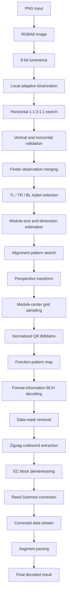

# QR Code Detector and Decoder in C++17

A complete QR Code Model 2 detection and decoding pipeline built from scratch in C++17.

The project starts with PNG pixels and implements the full path to a decoded payload: luminance conversion, adaptive binarization, finder detection, geometric correction, module sampling, format decoding, data unmasking, codeword extraction, Reed-Solomon correction, and payload parsing.

It does **not** use OpenCV, ZXing detector/decoder APIs, or another barcode library. ZXing-C++ was used only as an algorithmic reference.

## Highlights

- End-to-end QR detection and decoding from a source image.
- QR Code Model 2 **Versions 1-40**.
- Error-correction levels **L, M, Q, and H**.
- All eight data-mask patterns, **0-7**.
- Complete version/EC block-layout table covering all 160 combinations.
- Reed-Solomon correction implemented in QR's `GF(256)` field.
- Numeric, alphanumeric, byte, and mixed-segment payloads.
- Perspective correction and normalized module-grid sampling.
- Explicit validation failures and detailed visual diagnostics.
- Optional CLAHE preprocessing and arbitrary-angle input rotation.
- Only one small project-local dependency: LodePNG for PNG I/O.

## Verified End-to-End Result

Running the current baseline image:

```bat
run.bat images\test.png
```

produces:

```text
QR dimension estimation: accepted
Estimated QR dimension: 25 x 25 modules (version 2)
Format information: EC level M, data mask 2
Reed-Solomon correction: accepted
Blocks with errors: 1, corrected codewords: 2
Parsed QR segments: 2
Decoded QR result: www.checko.ai/?l=B04FN9JD
```

| Input and finder geometry | Rectified module grid |
|---|---|
|  |  |

| QR structural regions | Codeword traversal |
|---|---|
|  |  |

## Supported QR Coverage

| Capability | Support |
|---|---|
| QR family | QR Code Model 2 |
| Versions | 1-40 (`21x21` through `177x177`) |
| Error-correction levels | L, M, Q, H |
| Data masks | 0-7 |
| Block layouts | All 160 version/EC combinations |
| Payload modes | Numeric, alphanumeric, byte, and mixed supported segments |
| Input format | PNG |
| Polarity | Normal black-on-white |
| Symbols per image | One |

## Pipeline



The normalized `BitMatrix` is the boundary between detection and decoding. After grid sampling, the decoder no longer depends on the source image.

## Detection

### Image and luminance

- LodePNG decodes input into an owned RGBA8 `Image`.
- Pixels use row-major indexing: `4 * (y * width + x)`.
- Luminance is calculated using an integer approximation:

```text
Y = (306*R + 601*G + 117*B + 512) >> 10
```

- The coefficients sum to 1024, allowing rounded integer arithmetic without floating-point conversion.

### Local binarization

- Divides luminance into `8x8` pixel blocks.
- Measures minimum, maximum, mean, and dynamic range per block.
- Uses a dynamic-range cutoff of `24` for low-contrast handling.
- Corrects low-contrast thresholds from upper, left, and diagonal neighbors.
- Smooths black points over a `5x5` block neighborhood.
- Stores black as `1` and white as `0` in `BitMatrix`.
- Includes global Otsu thresholding as an independent comparison output.


### Finder discovery and validation

- Scans every third row for alternating black-white-black-white-black runs.
- Tests the QR finder ratio `1:1:3:1:1`.
- Uses fast center-run and neighboring-run plausibility checks before the detailed ratio calculation.
- Calculates the candidate center from the middle of the central black run.
- Cross-checks vertically through every horizontal hit.
- Refines the vertical center and performs a second horizontal scan.
- Records diagonal agreement as an additional concentric-pattern diagnostic.
- Preserves explicit rejection reasons for incomplete scans, invalid ratios, inconsistent sizes, and displaced centers.


Baseline candidate reduction:

```text
968 black-starting five-run windows
108 fast-plausibility passes
23 horizontal ratio passes
8 cross-direction validated observations
3 merged physical finder clusters
1 selected TL/TR/BL triplet
```

### Finder geometry

- Merges repeated observations using center-distance and module-size compatibility.
- Evaluates every three-cluster combination.
- Orders the selected points as top-left, top-right, and bottom-left.
- Rejects degenerate, collinear, size-inconsistent, non-right-angle, and side-inconsistent triplets.
- Scores valid triplets and selects the lowest-error geometry.
- Estimates pixels per module from the selected finder measurements.
- Computes independent top and left symbol dimensions.
- Corrects estimates to the valid Model 2 sequence `21, 25, ..., 177`.

```text
continuous dimension = finder-center distance / module size + 7
version = (dimension - 17) / 4
```

### Alignment and perspective

- Handles Version 1 without an alignment pattern.
- Predicts the bottom-right alignment target for Version 2 and above.
- Searches locally for concentric equal-width runs.
- Validates candidates along both axes and scores them against the prediction.
- Builds ideal-to-image and image-to-ideal projective transforms.
- Solves the eight homography coefficients using Gauss-Jordan elimination with partial pivoting.
- Reprojects control points to verify the transform.


### Grid sampling

- Transforms every logical module center `(column + 0.5, row + 0.5)` into source-image coordinates.
- Rejects non-finite and out-of-bounds projections.
- Samples exactly one value for every expected module coordinate.
- Validates duplicates, missing records, failed samples, and inconsistent centers.
- Produces a normalized, row-major QR `BitMatrix`.

The baseline Version 2 symbol samples all `625` module centers successfully.

## Decoding

### Function-pattern map

- Reserves finder patterns and separators.
- Reserves timing patterns, alignment patterns, format information, the fixed dark module, and Version 7-40 version-information regions.
- Generates alignment centers for Versions 1-40, including the Version 32 spacing case.
- Separates function modules from data/remainder modules before traversal.

### Format information

- Reads both standard 15-bit copies, most-significant bit first.
- Removes the fixed format mask `0x5412`.
- Generates all 32 legal BCH `(15,5)` codewords using polynomial `0x537`.
- Corrects up to three format-bit errors using Hamming distance.
- Decodes error-correction level and mask ID.

The baseline copies agree exactly and decode to EC level `M`, mask `2`.

### Data-mask removal

- Implements all eight Model 2 mask predicates.
- Applies the selected predicate only to data/remainder positions.
- Preserves every function module.
- Retains the original normalized matrix for diagnostics.

### Raw codeword extraction

- Starts at the bottom-right of the normalized symbol.
- Traverses two columns at a time in alternating vertical directions.
- Reads the right module before the left module.
- Skips timing column 6 and every function module.
- Packs complete groups of eight bits most-significant bit first.
- Reports remainder bits separately.

### Block layout and deinterleaving

- Contains the complete QR Model 2 block-layout table for Versions 1-40 and EC levels L/M/Q/H.
- Supports single and multiple block groups.
- Supports layouts where longer blocks contain one additional data byte.
- Reverses QR interleaving into independent data and EC blocks.
- Validates that every raw codeword is consumed exactly once.

### Reed-Solomon correction

- Implements QR's `GF(256)` field using primitive polynomial `0x11D`.
- Builds exponent and logarithm tables.
- Evaluates syndromes for every block.
- Uses the Euclidean algorithm to obtain error-locator and error-evaluator polynomials.
- Uses Chien search to locate corrupted bytes.
- Uses Forney magnitudes to repair them.
- Requires zero post-correction syndromes before accepting a block.

```text
maximum unknown byte errors per block = floor(EC codewords / 2)
```

For the baseline Version 2-M block, two bytes are corrected within an eight-byte correction capacity.

### Payload parsing

- Reconstructs corrected data bytes in logical block order.
- Parses four-bit mode indicators.
- Uses version-dependent character-count widths.
- Supports numeric groups of 3, 2, or 1 digits.
- Supports the QR 45-character alphanumeric alphabet.
- Preserves byte-mode values exactly.
- Supports multiple sequential segments.
- Stops at the QR terminator.
- Rejects truncated fields, invalid values, unsupported modes, and inconsistent metadata.
- Uses all-or-nothing final assembly: failures never expose partial decoded text.

Baseline segments:

| Mode | Count | Value |
|---|---:|---|
| Byte | 17 | `www.checko.ai/?l=` |
| Alphanumeric | 8 | `B04FN9JD` |

Final payload:

```text
www.checko.ai/?l=B04FN9JD
```

## Build

The current scripts target Windows and LLVM-MinGW.

1. Set `TOOLCHAIN` in `build.bat` and `run.bat` if LLVM-MinGW is stored elsewhere.
2. Build the executable:

```bat
build.bat
```

The executable is created at:

```text
build\qr_detector.exe
```

Compiler options:

```text
-std=c++17 -Wall -Wextra -O0 -g
```

## Run

Normal processing:

```bat
run.bat images\test.png
```

Optional CLAHE preprocessing:

```bat
run.bat images\test.png --clahe
```

Direct executable invocation after building:

```bat
build\qr_detector.exe images\test.png
```

Output locations:

| Mode | Directory |
|---|---|
| Normal | `output/` |
| `--clahe` | `output/clahe/` |

Input rotation is controlled by `InputRotationDegrees` in `src/main.cpp`:

- `0.0`: rotation code is bypassed.
- Positive value: clockwise rotation.
- Negative value: anticlockwise rotation.

## Diagnostics

The pipeline writes inspectable artifacts for each major decision:

| Output | Purpose |
|---|---|
| `01_luminance.png` | Grayscale source |
| `02_binary.png` | Local binary matrix |
| `03_horizontal_finder_hits.png/.txt` | Raw horizontal finder candidates |
| `04_vertical_crosscheck.png` | Vertical validation paths and outcomes |
| `04_validated_finder_hits.png` | Validated observations |
| `05_merged_finders.png/.txt` | Physical finder clusters |
| `06_all_finder_candidates_rejection_map.png` | Consolidated rejection map |
| `07_finder_triplet_selection.png/.txt` | Selected TL/TR/BL geometry |
| `10_alignment_pattern_search.png/.txt` | Alignment prediction and selection |
| `11_perspective_transform.png/.txt` | Projected symbol boundary and homography |
| `12_grid_sample_points.png/.txt` | Projected module centers |
| `13_normalized_qr_matrix.png/.txt` | Decoder input matrix |
| `14_function_pattern_map.png/.txt` | Function/data reservation map |
| `15_format_information.txt` | BCH-decoded EC level and mask |
| `16_unmasked_qr_matrix.png/.txt` | Unmasked symbol |
| `17_raw_codewords.txt` | Zigzag coordinates and extracted bytes |
| `18_error_correction_blocks.txt` | Block layout and deinterleaving |
| `19_reed_solomon_correction.txt` | Syndromes and byte corrections |
| `20_corrected_data_stream.txt` | Corrected parser input |
| `21_parsed_segments.txt` | Parsed segment boundaries and contents |
| `22_final_decoded_result.txt` | Final payload and metadata |

## Project Structure

```text
include/                 Public data structures and algorithm interfaces
src/                     Detection, geometry, sampling, and decoding code
tests/                   Focused standalone C++ tests
third_party/lodepng/     Project-local PNG dependency
images/                  Sample input images
output/                  Normal-run diagnostics and reports
output/clahe/            CLAHE-run diagnostics
build.bat                C++17 build entry point
run.bat                  Build-and-run entry point
PROGRESS.md              Detailed implementation state and verified results
```

## Verification

Focused tests cover:

- Luminance and image representations.
- Local thresholding, Otsu, and CLAHE.
- Horizontal finder ratios and center calculations.
- Cross-direction validation and rejection cases.
- Finder merging and triplet geometry.
- Module size, dimension, alignment, homography, and sampling.
- Normalized matrix and function-pattern construction.
- Both format-information copies and BCH correction.
- All eight data-mask predicates.
- Zigzag traversal and MSB-first byte packing.
- All 160 Model 2 version/EC block layouts.
- Mixed short/long block deinterleaving.
- Clean, correctable, maximum-capacity, and uncorrectable Reed-Solomon cases.
- Numeric, alphanumeric, byte, mixed-mode, truncated, and unsupported segments.
- Final-result consistency and binary byte preservation.

## Engineering Focus

- Algorithms are separated into focused headers and source files.
- Detection and decoding communicate through explicit intermediate structures.
- Constants and rejection tolerances are named and documented.
- Invalid intermediate states propagate as explicit failures.
- Debug output records why a candidate or decoding stage failed.
- The decoder operates only on the normalized matrix after sampling.
- Third-party use is limited to PNG encoding and decoding.

## Current Scope

The current implementation targets one standard black-on-white QR Code Model 2 symbol per PNG image.

The following are outside the present scope:

- Multiple QR symbols in one image.
- Inverted white-on-black symbols.
- Micro QR and rMQR.
- ECI character-set switching.
- Kanji mode.
- FNC1 and GS1 interpretation.
- Structured append.
- Automatic character-encoding selection for byte-mode data.

## Detailed Documentation

- [Project progress and verified results](PROGRESS.md)
- [Complete technical Word report](output/QR_Code_Detector_and_Decoder_Full_Project_Report_2026-10-08.docx)
- [Final decoded result](output/22_final_decoded_result.txt)

